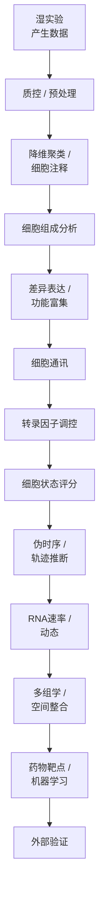

# scRNA-seq分析方法
## 一、完整分析链

## 1. 数据预处理与质控
**目的**：去除低质量细胞、双细胞、环境RNA，校正批次，使数据可靠。

- **质控**：过滤低质量细胞、高线粒体比例、低基因数细胞。
- **双细胞检测**：DoubletFinder、Scrublet、scDblFinder。
- **环境RNA校正**：SoupX、CellBender。
- **归一化**：LogNormalize、SCTransform、CPM。
- **批次校正**：Harmony、BBKNN、LIGER、Seurat Integration、scVI。
- **补全/去噪**：MAGIC、SAVER、scImpute、ALRA。

**常用工具**：CellRanger、STARsolo、Salmon alevin、Scanpy、Seurat。

## 2. 降维、聚类与细胞类型注释
**目的**：把细胞分成亚群，并判断每个亚群是什么细胞。

- **降维**：PCA、t-SNE、UMAP、Diffusion Map。
- **聚类**：Louvain、Leiden、SC3、SIMLR。
- **手动注释**：依据标记基因。
- **自动注释**：SingleR、CellTypist、scMap、CHETAH。
- **参考映射**：Seurat Label Transfer、Azimuth。
- **稀有亚群**：GiniClust、RaceID、SCA。
- **细胞比例差异**：scCODA、propeller、speckle。

**输出**：UMAP图、细胞亚群比例、标记基因热图。

## 3. 差异表达与功能富集
**目的**：找关键基因和通路。

- **差异表达**：Wilcoxon、MAST、DESeq2、edgeR、limma。
- **功能富集**：GO、KEGG、Reactome、GSEA、GSVA。
- **基因集打分**：AUCell、UCell、ssGSEA、AddModuleScore。
- **通路活性**：PROGENy、DoRothEA、SCENIC。
- **共表达网络**：WGCNA、hdWGCNA。

## 4. 细胞间通讯分析
**目的**：研究细胞亚群之间如何通过配体-受体互作。

- **常用工具**：CellChat、CellPhoneDB、NicheNet、iTALK、Connectome。
- **分析内容**：
  - 配体-受体对预测；
  - 信号通路活性；
  - 细胞群间通讯强度；
  - 疾病 vs 正常差异通讯；
  - 空间信息整合后的通讯。

**糖尿病应用**：免疫细胞与β细胞、巨噬细胞与肾小管细胞、小胶质细胞与神经元、施万细胞与DRG神经元。

## 5. 转录因子调控网络
**目的**：研究基因表达的上游调控机制。

- **常用工具**：SCENIC、pySCENIC、DoRothEA、ChEA3、Lisa。
- **输出**：转录因子活性评分、调控子网络、关键转录因子。
- **应用**：β细胞去分化、巨噬细胞极化、成纤维细胞活化、Müller细胞胶质化。

## 6. 细胞状态与功能评分
**目的**：不直接做轨迹，也可以给细胞打分。

- **细胞周期**：Seurat CellCycleScoring、cyclone。
- **干性/分化**：Stemness score、CytoTRACE。
- **衰老**：SenMayo、CellAge、SenPred。
- **炎症/免疫**：ImmuneScore、ESTIMATE。
- **代谢状态**：scMetabolism、COMPASS、MetaFlux、scFEA。
- **应激**：热休克、UPR、氧化应激基因集。
- **铁死亡/焦亡/自噬**：基于相关基因集打分。

## 7. 拷贝数变异与恶性细胞识别
**目的**：推断CNV，区分恶性与非恶性细胞。肿瘤常用，也可用于异常增殖研究。

- inferCNV、CopyKAT、CONICSmat、CaSpER。

## 8. 可变剪接分析
**目的**：研究同一基因的不同转录本。

- BRIE、Expedition、Outrigger、scASfind。
- **输出**：剪接事件、亚型比例、疾病相关剪接变化。

## 9. 伪时序分析 / 轨迹推断
**定义**：伪时序分析是通过细胞间转录组相似性，构建细胞状态转变的连续轨迹，推断细胞分化、激活、去分化或转分化的顺序。  
**核心问题**：这些细胞从哪来？往哪去？中间经历哪些状态？

### 常用工具对比

| 工具 | 特点 | 适用场景 |
|---|---|---|
| Monocle2/3 | 反向图嵌入，支持分支 | 经典轨迹、分支分析 |
| Slingshot | 基于聚类，平滑曲线 | 多分支、简单稳定 |
| TSCAN | 最小生成树 | 快速初步轨迹 |
| PAGA | 轨迹图抽象，与UMAP结合 | 大规模数据、拓扑结构 |
| Palantir | 吸收马尔可夫链，命运概率 | 细胞命运概率 |
| CellRank | 结合RNA速率和表达相似性 | 命运概率、方向性更强 |
| CytoTRACE | 分化潜能评分 | 辅助判断根节点 |
| Waddington-OT | 最优传输 | 时间序列、发育轨迹 |

### 分析步骤
1. 选择目标细胞亚群（如β细胞、巨噬细胞、Müller细胞、施万细胞）。
2. 降维（PCA/UMAP）。
3. 选择根节点：依据生物学知识，或用CytoTRACE辅助。
4. 构建轨迹：Monocle3、Slingshot、PAGA、Palantir等。
5. 计算拟时间（pseudotime）。
6. 找随拟时间变化的基因。
7. 分支分析：找分支特异基因和命运决定点。
8. 与RNA velocity/CellRank联合，增强方向性。
9. 功能富集：GO/KEGG/GSEA。
10. 外部验证：bulk RNA-seq、空间转录组、湿实验。

### 输出
- 拟时间排序；
- 轨迹图、分支树；
- 命运概率；
- 随拟时间变化的基因热图；
- 分支特异基因；
- 关键转折点。

### 注意事项
- 根节点选择主观，方向可能倒置；
- 循环轨迹、采样偏差会影响结果；
- 伪时序是推断，不是真实时间；
- 需要结合生物学知识和实验验证；
- RNA velocity 与伪时序不同：前者基于剪接动态，后者基于表达相似性。

### 糖尿病研究应用
- T2DM：β细胞去分化轨迹、α细胞转分化；
- DKD：足细胞损伤轨迹、巨噬细胞M1/M2极化轨迹；
- DR：Müller细胞胶质化轨迹、小胶质细胞激活轨迹；
- DPN：施万细胞去分化/脱髓鞘轨迹、DRG神经元状态转变。

## 10. RNA速率与动态分析
**目的**：利用未剪接/已剪接mRNA比例，推断细胞状态转变方向。

- **工具**：Velocyto、scVelo、dynamo、CellRank、Waddington-OT。
- **输出**：RNA速率向量、命运概率、动态驱动基因。
- **与伪时序关系**：常联合使用，RNA velocity提供方向，伪时序提供轨迹。

## 11. 免疫组库与克隆分析
**目的**：分析T细胞/B细胞受体克隆。

- **工具**：scRepertoire、Immcantation、VDJtools、Cell Ranger VDJ。
- **分析**：克隆扩增、克隆多样性、亚群克隆共享。
- **应用**：1型糖尿病自身免疫、移植免疫。

## 12. 多组学整合
**目的**：联合转录组、表观组、蛋白组、空间组。

- **多模态整合**：Seurat WNN、MOFA+、TotalVI、MultiVI、LIGER。
- **转录组+表观组**：10x Multiome、ArchR、Signac。
- **转录组+蛋白**：CITE-seq、TotalVI。
- **转录组+空间**：Seurat、Squidpy、Giotto、stLearn。

## 13. 空间转录组整合分析
**目的**：补上scRNA-seq丢失的空间信息。

- **工具**：Seurat、Squidpy、Giotto、stLearn、Cell2location、RCTD。
- **分析**：细胞类型空间分布、空间邻域、细胞共定位、空间通讯。
- **平台**：Visium HD、Xenium、Stereo-seq。

## 14. 药物靶点与扰动预测
**目的**：从单细胞数据预测药物响应和靶点。

- **药物连接图**：Connectivity Map、LINCS。
- **单细胞药物响应**：scDrug、Drug2Cell、scPerturb。
- **CRISPR扰动**：Perturb-seq、MUSIC、CellOracle。
- **机器学习**：随机森林、SVM、XGBoost、深度学习。

## 15. 机器学习与深度学习
- **细胞分类**：随机森林、SVM、XGBoost。
- **聚类**：Autoencoder、scDeepCluster、scDCC。
- **批次校正**：scVI、scANVI、Harmony。
- **细胞注释**：CellTypist、SingleR。
- **临床关联**：Cox模型、LASSO、随机生存森林。

## 16. 其他特色分析
- **基因调控网络**：GENIE3、SCODE、PIDC。
- **细胞相似性**：SNN、Jaccard。
- **代谢通量**：COMPASS、MetaFlux、scFEA。
- **细胞衰老**：SenPred、scAge。
- **微生物-宿主互作**：若数据含微生物序列。

