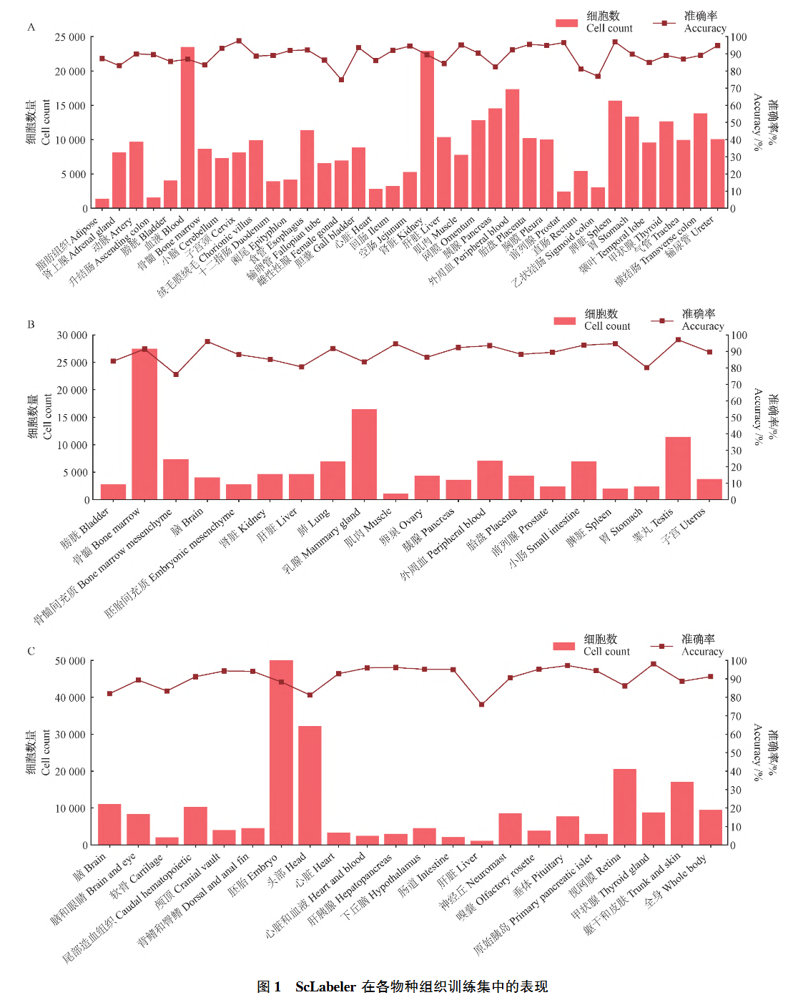
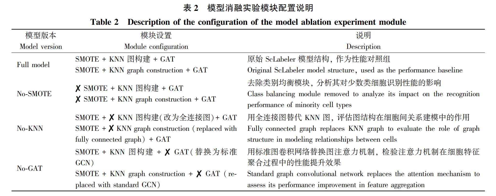
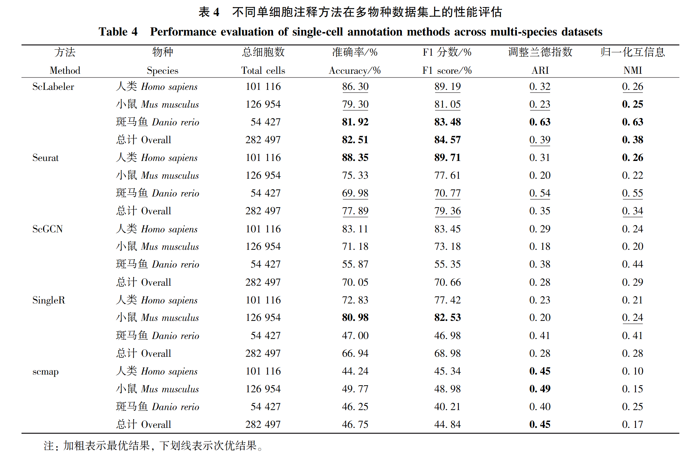

# 基于图注意力网络(GAT)的单细胞类型注释方法研究

> 孙熠伟 ·  · 

[打开 PDF](origin.pdf)

## 收获
1. smote策略解决样本不平衡
2. 数据清洗
3. 数据
## 创新点
构建细胞注释模型ScLabler——结合smote策略， GAT, KNN
## 研究问题

## 背景
1. 2021： scGCN——构建细胞图并应用图卷积神经网络
2. 2021： scDeepSort——基于加权图神经网络， 将细胞和基因作为图节点
## 方法
数据集： 人类， 小鼠， 斑马鱼
- 评估指标： F1, ACC, 漏检率， 运行时间
### 1. 数据预处理
1. 所有数据转化为基因表达矩阵文件及细胞类型文件
2. 基因表达矩阵文件处理
	1. 去除在全部细胞中不表达的基因
	2. 去除表达基因小于200的基因（细胞质量差）
	3. 去除表达小于3个细胞的基因——其可能是噪声
	4. 去除线粒体基因比例大于5%的细胞
	5. Seurat归一化
## 关键结论
#### 1. 模型在不同物种， 不同组织的模型性能差异明显

### 2. 消融实验

### 3. 与其他模型的比较

## 待办

- [ ] 
