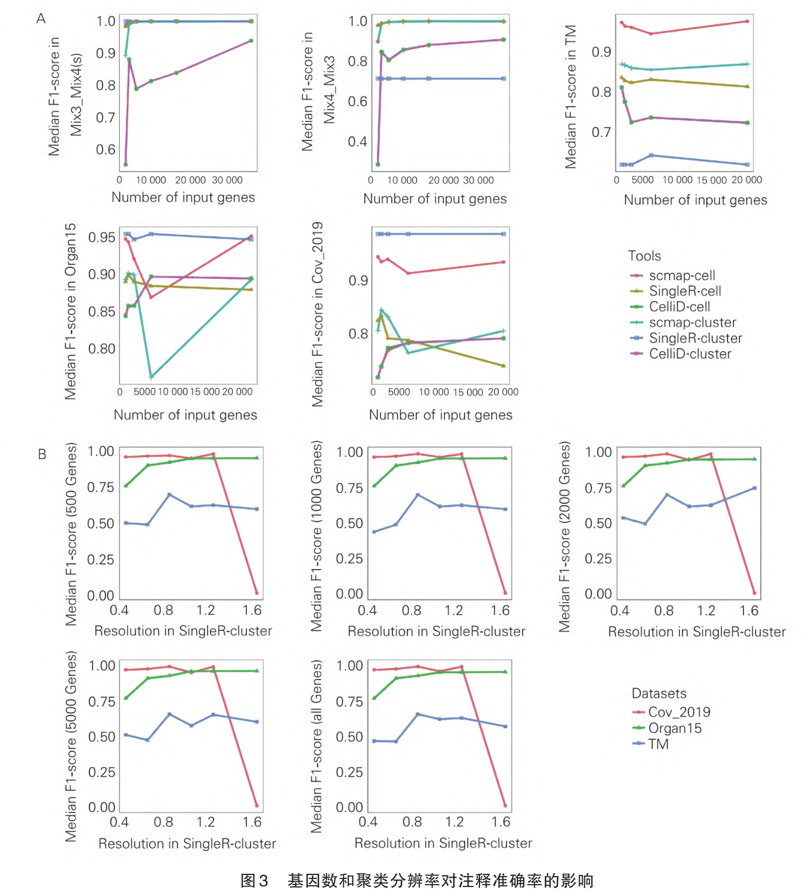
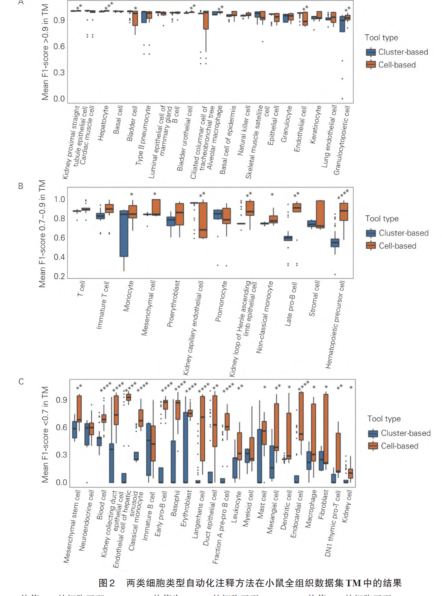
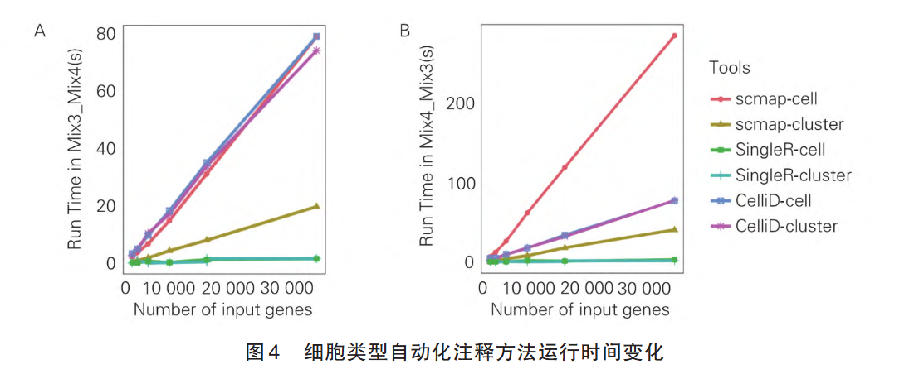

# 基于单细胞转录组数据集的细胞类型自动注释方法评估研究

> 康其传 ·  · 

[打开 PDF](origin.pdf)

## 收获
1. 细胞注释时注释单个细胞的准确率比以簇为单位的准确度要高
2. 数据集
3. 基因数和聚类分辨率对模型性能的影响
## 创新点

## 研究问题
比较各个细胞类型自动注释的模型性能
## 背景
## 方法
- 评估指标： F1, 漏检率， 运行时间
- 评估工具： scamp, singleR, CelliD(cluster-based and cell-based)
- 数据集： GSE128982， GSE109774（小鼠全组织细胞图谱）， GSE159929（人类15种组织数据集）， HRA000150（新型冠状病毒感染者外周血数据集）
## 关键结论
### 1. 模型评估结果
```
CelliD模型效果最差， scamp在基因数为5000时有明显下降， singleR综合表面最好
singleR-cell比singleR-cluster效果好， 但是二者都存在过拟合， 陌生数据集表面不好
```


### 2. cluster-based与cell-based的比较
```
cell-based的各个组织表现显著高于cluster-based
```


### 3. 运行时间比较
```
除scamp外， singleR, CelliD的cluster-based与cell-based的差别不大， 主要区别在模型
运行时间： scamp-cell > CelliD > scampe-cluster > singleR
```

## 待办

- [ ] 
