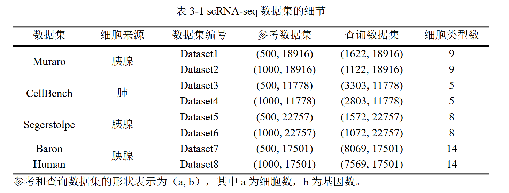
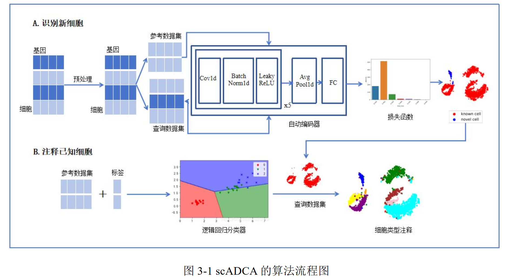
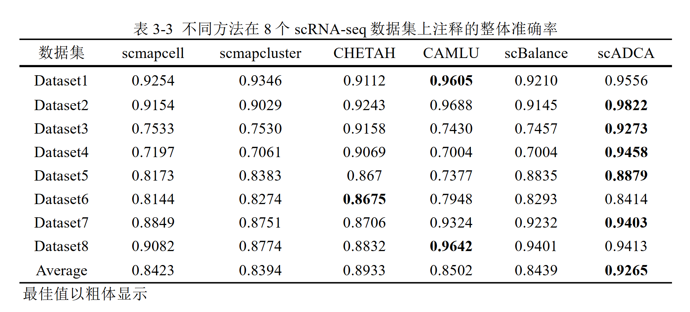
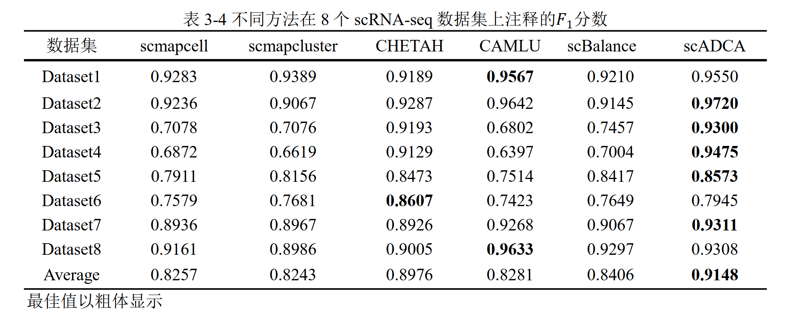
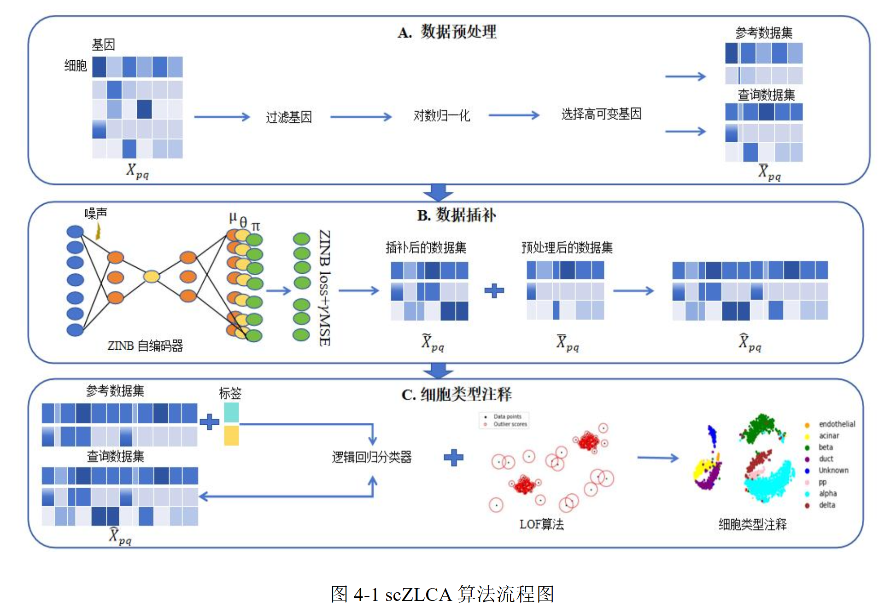
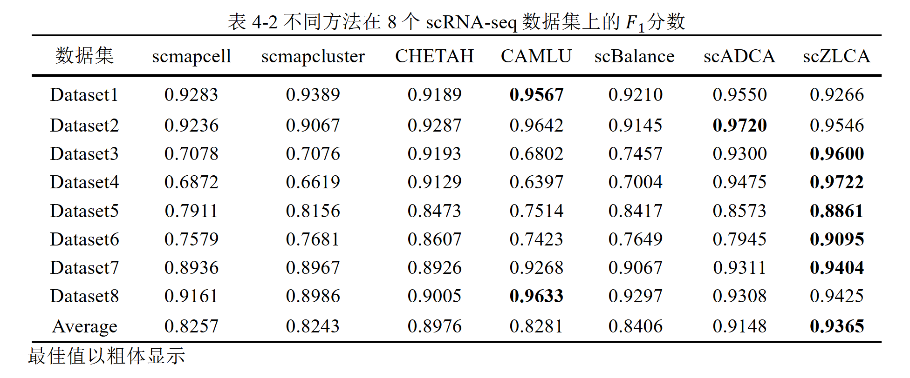
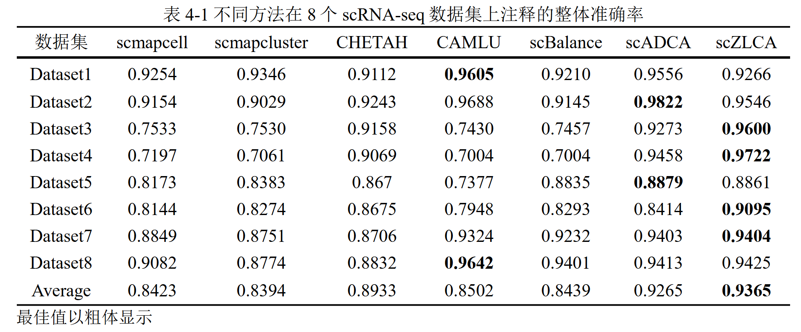

# 基于单细胞转录组数据的细胞类型注释算法研究

> 石永乐 ·  · 

[打开 PDF](origin.pdf)

## 收获
1. 数据集
2. ZINB算法和LOF算法
3. 基于重构误差识别新细胞
4. 细胞类型注释的发展（已有模型及方法）
## 创新点

## 研究问题

## 背景
- scRNA-SEQ数据分析步骤：
	1. 数据预处理： 质量控制， 数据标准化， 数据校正与整合
	2. 上游分析： 特征选择， 降维， 可视化
	3. 下游分析： 聚类， 细胞类型注释， 轨迹分析等
- 细胞类型注释
	- 定义： 基于基因表达谱将标签或身份分配给单个细胞或簇的过程
	- 细胞类型注释方法分为：
		1. 基于标记基因的方法——从Panglaodb或CelMarker等数据库获得典型标记
		2. 基于参考的方法： 查询数据集中表达出相似基因表达谱的细胞——准确度相对较高
	- 发展历程
		1. 2018： CaSTLe——基于迁移学习选择具有最高平均表达和互信息增益的基因， 将特征从连续值转化为4个有序区间， 并基于XGBoost构建分类， 输出分类概率和类别标签
		2. 2019： SingleR——基于参考细胞类型集的相似性注释细胞
		3. 2019： SingleCellNet——基于随机森林分类器， 通过找到最具鉴别力的基因对集合， 随后训练数据被转化成二进制矩阵并训练随机森林分类器实现细胞注释
		4. 2020： scCATCH——基于标记基因的方法。先进行聚类， 随后比对每个簇的特异表达基因与已知标记基因进行分类
		5. 2021： scDeepSort——使用预先训练稀有或中间细胞类型的GNN
		6. 2022： scMRMA——基于标记基因的方法进行分层注释
		7. 2023： scAnnotate——使用双组分混合模型对基因脱落水平和表达水平建模， 对每个基因构建弱分类器， 并使用组合器函数集成弱分类器到强分类器完成注释
		8. 2023： scBalance——稀疏神经网络
	- 注释未知细胞的发展历程
		1. 2018： scmap——基于标记基因， 采用余弦相似性， 皮尔逊与斯皮尔曼相关性度量， 通过计算与参考细胞类型的相似性完成注释。然而， 其依赖经验阈值。
		2. 2019： Garnett——基于标记基因， 利用弹性网络回归注释， 为了解决细胞分类模糊的情况， 当得分最高与得分第二高的细胞类型比值低于1.5， 设置为未知细胞类型
		3. 2019： SCINA——不表达任何特定细胞类型标记基因的细胞为新细胞
		4. 2019： CHETAH——基于差异表达基因评分和斯皮尔曼相关性
		5. 2020： CellBlast——基于VAE和Wasserstein距离和经验p值映射细胞到特定类型
		6. 2020： scLearn——基于判别成分分析变化矩阵计算细胞类型相似度， 相似度过低时判别为未知
		7. 2021： scHPL——基于分类树进行分层注释， 并加入拒绝机制
		8. 2021： scGCN——基于图卷积神经网络
		9. 2022： scAnnotatR——结合多个相似性度量算法和SVM分类器
		10. 2022： scBERT——基于bert模型， 当没有置信度高的细胞类型时则标记为未知
## 方法
### 1. 构建scADCA模型
scADCA(Anomaly Detection-based Cell Type Annotation of scRNA-seq dataset)
#### 1.1 数据集

每个个数据集， 根据细胞比例随机选择1000/500个样本作为参考数据集， 其余作为查询数据集。总共在八个数据集进行预测和评估。
#### 1.2 模型算法
模型算法分为识别新细胞和注释已知细胞两个阶段

##### 1.2.1 识别新细胞
通过卷积模块和全连接层学习输入数据特征， 进行编码和解码， 重构数据集。基于重构误差， 可以区分输入数据中的新细胞和已知细胞。
##### 1.2.2 注释已知细胞
使用参考数据集及对应标签训练逻辑回归分类器
#### 1.3 模型性能

### 2. 构建scZLCA模型
based on ZINB model and LOF algorithm

#### 2.1 模型算法
该模型基于ZINB算法和LOF算法
##### 2.1.1 ZINB算法： 
零膨胀负二项， 可以有效解决数据中过度零值和过度离散性
$$
\begin{align}
f_{NB}(\overline{X}_{pq}; \mu_{pq}, \theta_{pq}) &= \frac{\Gamma(\overline{X}_{pq}+\theta)}{\overline{X}_{pq}!\Gamma(\theta_{pq})} \left(\frac{\theta_{pq}}{\theta_{pq}+\mu_{pq}}\right)^{\theta_{pq}} \left(\frac{\mu_{pq}}{\theta_{pq}+\mu_{pq}}\right)^{\overline{X}_{pq}} \tag{4.1} \\
f_{ZINB}(\overline{X}_{pq}; \pi_{pq}, \mu_{pq}, \theta_{pq}) &= \pi_{pq}\delta_0(\overline{X}_{pq}) + (1 - \pi_{pq})f_{NB}(\overline{X}_{pq}; \mu_{pq}, \theta_{pq}) \tag{4.2} \\

\delta_0(\overline{X}_{pq}) &= 
\begin{cases} 
1 & \overline{X}_{pq} \\ 
0 & otherwise 
\end{cases} \tag{4.3}
\end{align}
$$

1. ZINB自编码器在训练过程中训练出$\mu_{pq}, \sigma_{pq}, \pi_{pq}$, 其分别代表平均值， 离散度， 丢失概率
2. $f_{NB}$代表负二项分布的概率质量函数
3. $f_{ZINB}$代表零膨胀负二项分布的概率质量函数
4. 狄拉克函数$\delta_0$
$$
\begin{align}
E &= ReLU\left( (\overline{X}_{pq} + e)W_E \right) \quad W_E \in \mathbb{R}^{n \times 64} \tag{4.4} \\
B &= ReLU(EW_B) \quad W_B \in \mathbb{R}^{64 \times 32} \tag{4.5} \\
D &= ReLU(BW_D) \quad W_D \in \mathbb{R}^{32 \times 64} \tag{4.6}
\end{align}
$$
5. E：为编码器输出
6. e： 高斯噪声
7. B： 隐藏层输出
8. D： 解码器输出
##### 2.1.2 LOF算法
局部离群因子算法： 通过比较数据点与邻居的密度差异识别异常点。用于识别新细胞
1. Step 1：找邻居（k 距离邻域）
  $$N_k(p_1) = \{d(p_1, p^*) \le d_k(p_1)\} \tag{4.26}$$
  找出距离细胞 p_1 最近的 k 个细胞（本文 k=5）。
2. Step 2：量距离（可达距离）
$$d_k(p_1, p_2) = \max\{d_k(p_1), d(p_1, p_2)\} \tag{4.24}$$
  防止两个细胞太近导致距离为 0（除零错误）。规定实际距离不能小于其 k 距离。
3. Step 3：算密度（局部可达密度 lrd）
$$lrd_k(p_1) = \frac{1}{\frac{\sum_{p_2 \in N_k(p_1)} d_k(p_1, p_2)}{|N_k(p_1)|}} \tag{4.25}$$
  密度是距离的倒数。周围邻居挨得越近，平均距离越小，密度 lrd 越大。
4. Step 4：算比值（局部离群因子 LOF）
  $$LOF_k(p_1) = \frac{\sum_{p_2 \in N_k(p_1)} \frac{lrd(p_2)}{lrd(p_1)}}{|N_k(p_1)|} \tag{4.27}$$
用“邻居的平均密度”除以“自己的密度”。
#### 2.2 模型性能

## 关键结论

## 待办

- [ ] 
